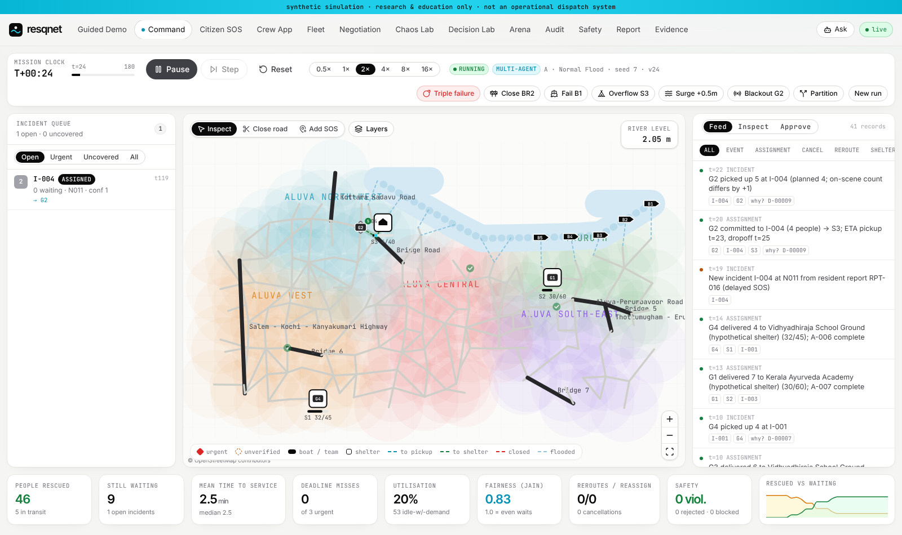

# Data provenance

Everything the application ships with is **synthetic or generated by this repository**, except one real map: the **Aluva, Kerala** road and river network from OpenStreetMap (below). No real SOS messages or real incidents are included.

| Data | Location | Origin | Licence / terms |
|---|---|---|---|
| Riverbend city graph | `backend/app/simulation/world.py` | Generated procedurally (fixed seed 2026) | Part of this repository |
| Incidents, reports and false alarms | Generated per run from the scenario seed | Synthetic | Part of this repository |
| Riverbend gazetteer (landmarks and multilingual aliases) | `data/geographic/riverbend_gazetteer.json` | Hand-written fictional places, marked `"synthetic": true` | Part of this repository |
| SOS evaluation set (54 messages: English, Hindi, Malayalam) | `data/evaluation/sos_cases.jsonl` | Written for this project. Not real messages and not translations of real messages | Part of this repository |
| Benchmark results | `data/evaluation/benchmarks/` | Generated by `scripts/run_benchmarks.py` from the simulator | Reproducible from the code and seeds |
| OSM test fixture "Testvale" | `backend/tests/fixtures/testvale.osm` | Hand-made **fictional** town in OSM XML format, placed near 0°N 0°E (in the ocean) so it cannot be mistaken for a real place. Used only by tests | Part of this repository |

## Real-world data: Aluva, Kerala (OpenStreetMap)



| Data | Location | Origin | Licence / terms |
|---|---|---|---|
| Aluva OSM extract (central Aluva and the Periyar, about 2.7 km × 1.6 km; bounds 10.1025–10.1173 N, 76.3488–76.3732 E) | `data/geographic/sources/aluva.osm` | Exported from openstreetmap.org | ODbL 1.0, © OpenStreetMap contributors |
| Aluva city file (147 junctions, 204 road links, 8 bridges, river, 391 named landmarks) | `data/geographic/aluva.city.json` | Built by `scripts/build_geo.py` from the extract above | ODbL 1.0 derived database (share-alike) |

Rebuild it with:

```bash
python scripts/build_geo.py --osm-file data/geographic/sources/aluva.osm --name "Aluva, Kerala" --out aluva --river-step-km 0.2
```

What is real and what is not, on the Aluva map:

- **Real (`osm-derived`):** road geometry and names, bridges, the river line, landmark names (used by the SOS gazetteer), and the "Thuruth" place name.
- **Assumed (`scenario-assumed`):** ground elevation (a proxy from distance to the river; no DEM), jetties and bridge clearances.
- **Hypothetical:** shelters. They sit on real named places (for example a school ground) but are not verified relief camps.
- **Generated:** neighbourhood names other than Thuruth ("Aluva West", "Aluva Central" and so on, by direction).
- **Synthetic:** the flood, incidents and SOS reports. **No result on this map describes the 2018 Kerala floods.**

Exports include every node of every way touching the box, so the converter trims to the extract's bounds; otherwise the full Periyar would stretch the map.

### Still to add

The intended sources are:

| Layer | Source | Terms to respect |
|---|---|---|
| Roads, bridges, waterways, landmark names | OpenStreetMap, via `scripts/build_geo.py` (Overpass download or a saved .osm file; dependency-free converter) | ODbL: attribution "© OpenStreetMap contributors" and share-alike for the derived graph. No bulk tile downloads from the community tile servers. |
| Flood extent | A Copernicus EMS mapping product for the August 2018 Kerala floods | The specific product and its licence must be checked by a person before use. No product number is cited until then. |
| Elevation | A public DEM such as SRTM or the Copernicus DEM | Per-product terms |
| Shelters | Verified public records where available; otherwise clearly labelled hypothetical shelters | — |

Riverbend remains the default city. No result in this repository should be read as describing the 2018 Kerala floods.
